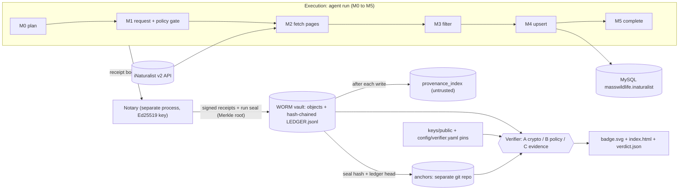

# MassWildlife Integrity Agent

A research prototype for the capstone **"Verifying the Integrity of Agentic Intelligence"** (University of
Arizona). A scheduled agent pulls new iNaturalist observations for *MassWildlife's All Wildlife Biodiversity
Project* into MySQL. Every step it takes leaves an Ed25519-signed, hash-chained **provenance receipt** in a
local write-once vault. An independent verifier checks those receipts at three levels (cryptographic, policy,
evidence) and reports the result as an **integrity badge**.

The research question:

> To what extent does policy- and evidence-aware verification reduce false integrity assurances compared with
> cryptographic receipt verification alone?

The design follows provenance-native receipts (Merkle-linked, Ed25519-signed records at every module boundary,
rooted in a signed Minimal Specification, PR0). It is a local equivalent of a cloud architecture:

| Cloud reference design | This prototype |
|---|---|
| Notary Lambda + KMS | a separate local notary process (`python -m mwia.notary serve`); the only process that decrypts the key |
| S3 Object Lock, Compliance Mode | `LocalWormVault` (write-once files, retention that can only grow, hash-chained ledger), or the optional `S3ObjectLockVault` |
| Aurora provenance index | MySQL `masswildlife.provenance_index` (an untrusted convenience; the verifier never reads it) |
| — | external anchors: each run's seal hash and the ledger head, committed to a separate git repo |

## Architecture



Each run is six modules. Each emits exactly one receipt at its boundary:

| Step | Receipt | Module | What it records |
|---|---|---|---|
| 0 | PR0 | plan | the Minimal Specification: window, declared steps, policy snapshot and hash, expected module measurements, notary key id, previous run's seal |
| 1 | PR1 | request | the exact request (URL, params, headers minus auth), the pre-execution policy gate decision, auth mode |
| 2 | PR2 | response | every raw response page as evidence, plus status, `total_results`, page count and timing |
| 3 | PR3 | filter | a decision with a reason code for every record (new / changed / unchanged / out of scope / ...) |
| 4 | PR4 | database | DB user, SQL operation types used, inserted / updated / skipped, and the readback after commit |
| 5 | PR5 | completion | count reconciliation and success / partial / failed. The notary then seals the run (Merkle root) |

`docs/PROJECT_BRIEF.md` has the full specification and the decisions made along the way.

## Repository layout

```
config/       policy.yaml (hashed into every PR0), tool_manifest.yaml (measured), settings.yaml, verifier.yaml (pins)
src/mwia/     common/ (JCS, Merkle, receipts, measurement)  notary/  vault/  index/  agent/  verify/
templates/    Jinja2 badge pages          sql/admin/  DDL the admin runs (the agent account can't run DDL)
eval/         evaluation harness, scenarios, metrics, results/      examples/  badges from synthetic runs
scripts/      mwia.py (CLI), run_daily.ps1 / run_daily.sh, register_task.ps1, precommit_check.py, ...
tests/        pytest suite + fixtures/    docs/  methodology, field mapping, scheduling, AI usage log
keys/public/  trusted notary public keys + keyring (the only key material in git)
```

Not in git: `.env`, `keys/private/`, `vault*/`, `anchors*/`, `data/`, `logs/`, `reports/runs/`.

## Setup

Requirements: Python 3.11+ (developed on 3.14), MySQL 8.0.19+, git. Windows, Linux and macOS are supported.

```powershell
python -m venv .venv
.venv\Scripts\python.exe -m pip install -r requirements.txt     # + requirements-s3.txt for the optional S3 backend
git config core.hooksPath .githooks                             # pre-commit secret check
```

(On Linux/macOS use `.venv/bin/python`.)

**Database (least privilege).** The agent connects as `claude`, which has only `SELECT, INSERT, UPDATE` on
`masswildlife.*`. It never needs DELETE, TRUNCATE, DDL or `REPLACE INTO`; upserts use
`INSERT ... ON DUPLICATE KEY UPDATE`. A MySQL admin runs the scripts in `sql/admin/` (see its README) to create
`provenance_index`, `agent_run_state` and `inaturalist_test`.

**Secrets (`.env`).** Copy `.env.example` to `.env` and fill it in yourself. Never paste secrets into chat or code.

| Variable | Purpose |
|---|---|
| `MYSQL_HOST`, `MYSQL_PORT`, `MYSQL_USER=claude`, `MYSQL_PASSWORD`, `MYSQL_DATABASE=masswildlife` | the agent's DB account. The password is never printed or logged |
| `NOTARY_KEY_PASSPHRASE` | encrypts the notary's private key (at least 12 characters) |
| `INAT_API_TOKEN` | optional. Reading public observations needs no token |

**Notary key.**

```powershell
.venv\Scripts\python.exe scripts\mwia.py notary keygen    # creates keys/private/<id>.key.pem (encrypted) + keys/public/<id>.pub.pem
.venv\Scripts\python.exe scripts\mwia.py notary rotate    # new active key; old public keys stay, so old receipts still verify
```

The private key is PKCS#8, encrypted with the passphrase, and readable only by your account (chmod 600 or an
owner-only ACL). Only the notary process loads it; the agent only sends bodies and receives signatures.

### iNaturalist token

The token is optional and expires after about 24 hours. On every run the agent decodes its `exp` claim. If the
token is missing, expired or expires within an hour, the run falls back to anonymous reads (allowed by
`auth.allow_anonymous`), records `auth_mode: anonymous` and the reason, and shows a **"token needs refresh"**
warning in the run report and on the badge page. The token itself is never printed, logged, hashed into a
receipt or committed.

- **Manual refresh:** paste a new token from https://www.inaturalist.org/users/api_token into `.env`.
- **Automated refresh:** the reliable route is an iNaturalist OAuth application. It isn't implemented in this
  prototype.

## Running

```powershell
# rehearse: receipted, but no database writes at all
.venv\Scripts\python.exe scripts\mwia.py agent run --dry-run --vault test --db test
# a real run against the test copy of the table
.venv\Scripts\python.exe scripts\mwia.py agent run --vault test --db test
# production (what the scheduler runs)
.venv\Scripts\python.exe scripts\mwia.py agent run --vault prod --db prod
```

Flags: `--dry-run`, `--vault prod|test`, `--db prod|test`, `--window-hours N` (the policy gate still applies).
Evaluation only: `--unsafe-bypass-gate` (requires `--vault test --db test`).

Each run writes `reports/runs/<run_id>/report.json`, verifies itself (configuration C), writes its badge and page,
and records the verdict in `provenance_index`.

| Exit code | Meaning |
|---|---|
| 0 | success, verified green |
| 1 | amber, partial or flagged |
| 2 | red, failed, or blocked by the policy gate |
| 3 | usage error |
| 4 | another run in progress |

The incremental window is `[previous verified window end − 10 min, now]`, capped at 24 h + 15 min. A missed day is
caught up to that cap and the gap is flagged; the window is never silently widened.

## Verifying

```powershell
.venv\Scripts\python.exe scripts\mwia.py verify --vault prod                       # newest run, configuration C
.venv\Scripts\python.exe scripts\mwia.py verify --vault prod --all
.venv\Scripts\python.exe scripts\mwia.py verify --vault test --run <run_id> --mode crypto --json
```

| Mode | Configuration | Checks |
|---|---|---|
| `crypto` | A | signatures, hashes, chain, nonces, evidence hashes, measurements, Merkle seal, ledger, anchors |
| `crypto+policy` | B | A + the policy re-evaluated from the signed PR0 snapshot and the verifier's own pins |
| `crypto+policy+evidence` | C | B + complete, fresh and reconcilable evidence |

The verifier is a separate, read-only program. Its only inputs are the vault, `keys/public/`, the anchors
file and `config/verifier.yaml`. It never imports agent code and never reads MySQL. There are exactly three
outcomes:

- **VERIFIED WITHIN SCOPE** (green): every enabled layer passed.
- **VERIFICATION FAILED** (red): proof of tampering, or a policy violation. The page shows the first failing step.
- **INSUFFICIENT EVIDENCE** (amber): nothing was proven wrong, but required evidence is missing, stale or doesn't add up.

A badge attests that the run was untampered, plan-conformant and policy-compliant, with sufficient recorded
evidence, as far as the configuration that produced it can see. **It does not attest that the observations
are factually correct.** See `examples/` for pages from synthetic runs, and `docs/VERIFICATION_METHODOLOGY.md`
for the threat model.

## Scheduling (once every 24 hours)

`scripts/run_daily.ps1` (Windows) and `scripts/run_daily.sh` (Linux/macOS) run `agent run --vault prod --db prod`,
then `verify`. They append to `logs/agent-YYYYMMDD.log` and exit non-zero on a red or amber result.
`docs/SCHEDULING.md` covers Task Scheduler (the `scripts\register_task.ps1` one-liner, `schtasks`, and the GUI
steps with *run as soon as possible after a missed start* and *do not start a new instance*), cron, and a launchd
plist for macOS.

## Reproducing the evaluation

```powershell
.venv\Scripts\python.exe eval\run_eval.py            # 12 scenarios x 30 repetitions x configurations A, B, C (about 4 min)
.venv\Scripts\python.exe eval\make_examples.py       # regenerate examples/
```

The harness runs the real pipeline offline (recorded fixtures cloned into synthetic observations, in-memory DB,
a throwaway notary key, one vault per trace) and never touches production. Every scenario has an independent
ground-truth label (legitimate / tampered / policy violation / insufficient). Results go to `eval/results/`:
`summary.md`, plus CSVs for per-trace verdicts, confusion matrices with denominators, false-assurance rates,
precision/recall/F1, false alarms, insufficient-evidence recognition, localization accuracy, latency, per-receipt
cost and storage overhead. Only measured numbers are written. The summary also lists the threats to validity,
and an earlier run that exposed a verifier bug is kept in `eval/results/archive/`.

## Honest limits

- **The local vault is tamper-evident, not tamper-proof.** Files are write-once, read-only and (on Windows)
  carry deny-delete ACEs, but their owner can rewrite the ACLs and an administrator can delete anything. The
  hash-chained ledger and the external anchors make deletion, rollback and rewriting **detectable**. An attacker
  who deletes the newest run and rewrites the ledger consistently is caught only by the anchors. Keep the anchor
  repo somewhere the vault's owner can't silently rewrite (push it, or email `anchors/anchors.txt` to yourself).
  POSIX directories stay writable, so there the protection is weaker than on Windows.
- **The notary runs on the same machine, under the same account.** Separation of duties is between processes
  (the agent never loads the key code or decrypts the key), not an OS security boundary. The threat model assumes
  the adversary does not hold both the notary key and the verifier.
- **The evidence comes from the agent.** Layer C checks that it is complete, fresh and internally consistent,
  not that iNaturalist's data is true. A fully compromised agent that also controls the notary key could sign
  fabricated but consistent evidence; this is outside the threat model.
- **The S3 Object Lock backend is tested only against a fake S3 client.** It has not been run against AWS.
- **The evaluation was designed by the same (AI-assisted) developer as the verifier.** It shows that the verifier
  meets its specification on these attacks, not robustness against unforeseen ones.

## Data, privacy and licences

- True or private coordinates are never requested or stored (`private_*` columns stay NULL). Only public,
  possibly obscured, coordinates are kept.
- `tests/fixtures/` holds 10 real iNaturalist observations (CC BY-NC) with observer identity pseudonymized. See its
  README for attribution. `examples/` contains synthetic runs only.
- The HTTP User-Agent is `masswildlife-integrity-agent/0.1`, and requests are rate-limited to at most 1 per second.
- The code is released under the [MIT License](LICENSE). The licence does not cover the iNaturalist records in
  `tests/fixtures/`, which keep their own CC BY-NC terms (see that folder's README).

## Tests and AI disclosure

`.venv\Scripts\python.exe -m pytest` runs the suite: unit tests, offline end-to-end runs, tamper cases and
verifier independence. `MWIA_DB_TESTS=1` adds a live DB test that writes only `env='test'` rows.

This project was built with AI assistance (Claude, via Claude Code). Every source file says what it does, that it
was AI-assisted, and which test verifies it. `docs/AI_USAGE.md` logs what was generated, how it was checked,
what the author reviewed, and every correction found by tests or the evaluation.
